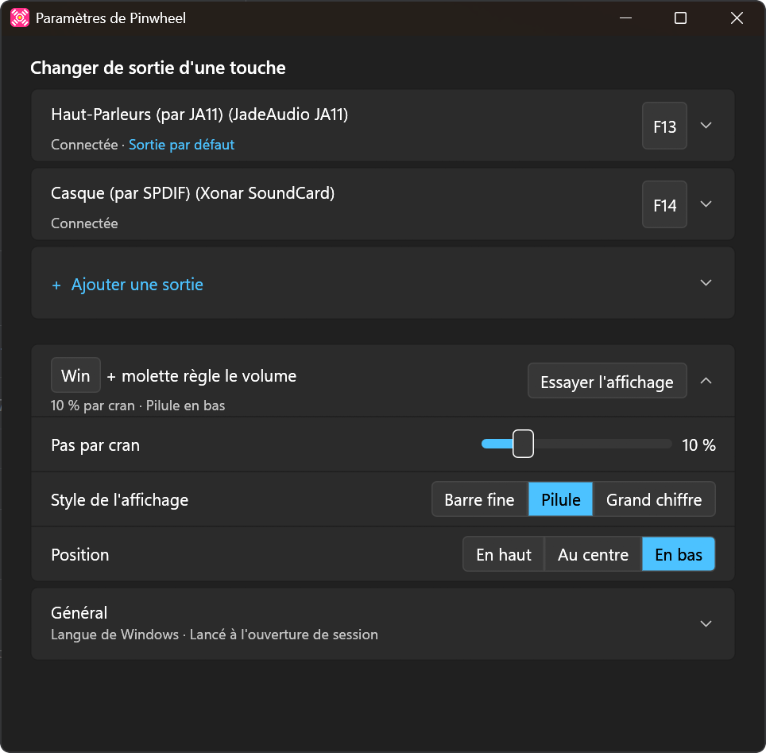
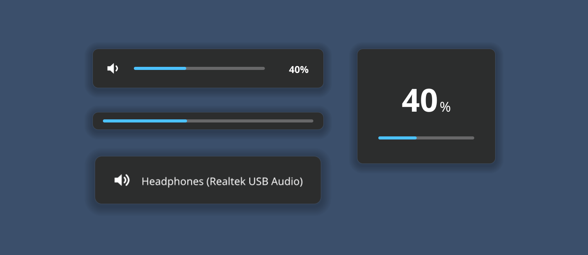
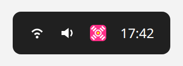
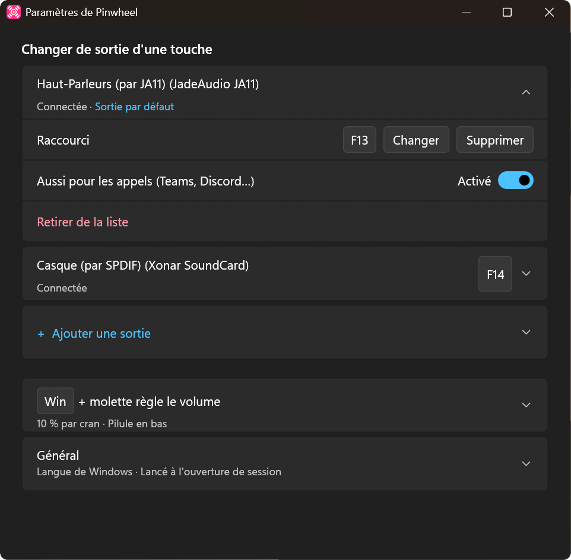

<p align="center">
  
</p>

<h1 align="center">Pinwheel</h1>

<p align="center">
  <b><kbd>⊞ Win</kbd> + scroll to change volume, one hotkey per audio output.</b><br>
  A small Windows 10/11 app that sits in the notification area.
</p>

<p align="center">
  <a href="https://github.com/KewinDousse/pinwheel-audio/releases/latest"></a>
  <a href="https://github.com/KewinDousse/pinwheel-audio/actions/workflows/ci.yml"></a>
  <a href="LICENSE"></a>
</p>

<p align="center">
  <a href="https://github.com/KewinDousse/pinwheel-audio/releases/latest/download/pinwheel.exe"><b>Download pinwheel.exe</b></a>
</p>

<p align="center">
  
</p>

## What it does

- **<kbd>⊞ Win</kbd> + scroll** changes the volume of the default output, 10% per wheel notch (adjustable). With Shift, 1% per notch. **Win + middle click** mutes.
- **One hotkey per output** makes it the default output: speakers on one key, headphones on another. Any key or combination works, media and macro keys included. Another hotkey can go to the next output of the list.
- **An on-screen display** shows the volume or the new output for 1 s (adjustable), then fades out. Three styles: thin bar, pill, big number.



If you used Volume2 for Win + scroll and Audio Switcher for output hotkeys, Pinwheel does both, and nothing more. The interface is in English or French: it follows the Windows display language, and can be changed in the settings.

## Install

1. Download `pinwheel.exe` from the [latest release](https://github.com/KewinDousse/pinwheel-audio/releases/latest) and put it in a local folder, such as `%LOCALAPPDATA%\Programs\Pinwheel\`. Windows often blocks executables started from a network share.
2. Run it. The settings window opens on the first run.
3. Turn on "Start Pinwheel when I sign in", in the General card, to start it automatically.

The executable is not code-signed, so SmartScreen may warn about it on the first run: click "More info", then "Run anyway". Each release comes with a `pinwheel.exe.sha256` file to check the download.

If you use Volume2, quit it and remove it from startup: with both running, Win + scroll would change the volume twice.

## Use



- Click the tray icon to open the settings. Right-click for the menu (Settings, Quit, and the newer release when there is one).
- Running `pinwheel.exe` again while it runs also opens the settings.
- Each output has its card. Open it to change or clear its hotkey, to use the output for calls as well, or to remove it from the list.
- Changes are saved and applied right away.



### Update check

At startup and once a day, Pinwheel asks GitHub for its latest release, and says so in the settings and the tray menu when a newer one is out. It never installs anything. That request is its only network access: turn it off with "Check for updates", in "About Pinwheel".

## Files

| File | Content |
|:--|:--|
| `%APPDATA%\Pinwheel\settings.json` | Settings |
| `%LOCALAPPDATA%\Pinwheel\logs\pinwheel.log` | Log ("Open folder" next to Logs, in the General card) |
| `%LOCALAPPDATA%\Pinwheel\status.json` | Hotkeys Windows refused and the newer release, read by the settings window |
| `%LOCALAPPDATA%\Pinwheel\window.txt` | Position and size of the settings window |

An unreadable settings file is renamed to `settings.json.<timestamp>.bak` instead of being overwritten.

## Development

Rust (edition 2024). The repository holds:

- `crates/core`: logic that does not depend on Windows (settings, shortcuts, interface texts, volume steps, wheel, output matching, drawing of the display). It builds and is tested on any OS.
- `crates/app`: the Windows app.
- `tools/make-icon`: generates `crates/app/res/pinwheel.ico`.

See [`docs/architecture.md`](docs/architecture.md), the decisions in [`docs/adr/`](docs/adr/), and [`CONTRIBUTING.md`](CONTRIBUTING.md).

### Tests

```sh
cargo test                     # crates/core
cargo run -p pinwheel-core --example osd-preview -- preview.png <font.ttf> [bold-font.ttf]
```

The `osd-preview` example draws every display style, in both languages, into one image.

On Windows, the CI's `e2e` job runs the exe on the runner's desktop and drives it with real keys and clicks ([`.github/e2e/e2e.ps1`](.github/e2e/e2e.ps1)): the Start menu entry, each card opening alone, the window opening where it was closed, the shortcut capture, Escape, a saved shortcut and the next output one, Win + wheel, Win + Shift + wheel and Win + middle click reaching Pinwheel, and Win + wheel and Win + middle click keeping Start closed while Win alone opens it. Its screenshots of the settings window are in the run's `e2e` artifact. The runner has no audio device, so what needs one follows [`docs/manual-tests.md`](docs/manual-tests.md).

### Build the Windows executable

On Windows: `cargo build -p pinwheel --release`.

From Linux, with [`cargo-xwin`](https://github.com/rust-cross/cargo-xwin) (which downloads the MSVC CRT and the Windows SDK, and accepts their license) and LLVM (`clang-cl`, `lld-link`, `llvm-rc`):

```sh
rustup target add x86_64-pc-windows-msvc
cargo install cargo-xwin --locked
scripts/build-windows.sh       # → target/x86_64-pc-windows-msvc/release/pinwheel.exe
```

`crates/app/build.rs` embeds the icon, the version information and the manifest (per-monitor DPI, no elevation) into the executable.

## License

[MIT](LICENSE)
